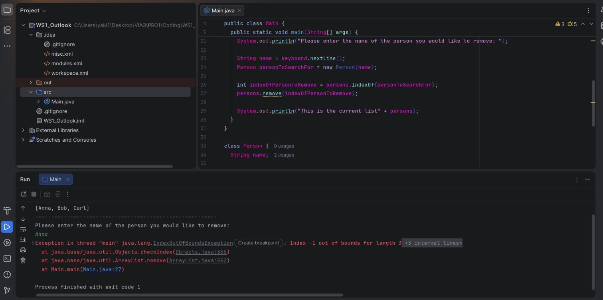
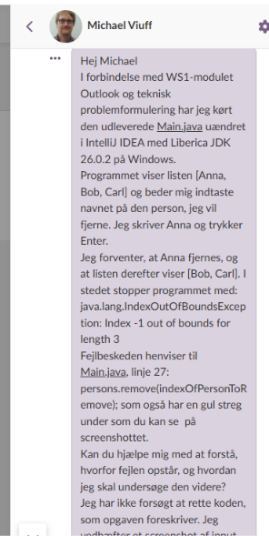
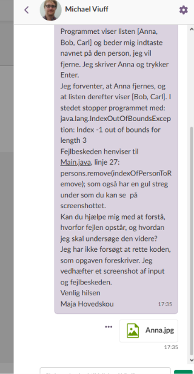
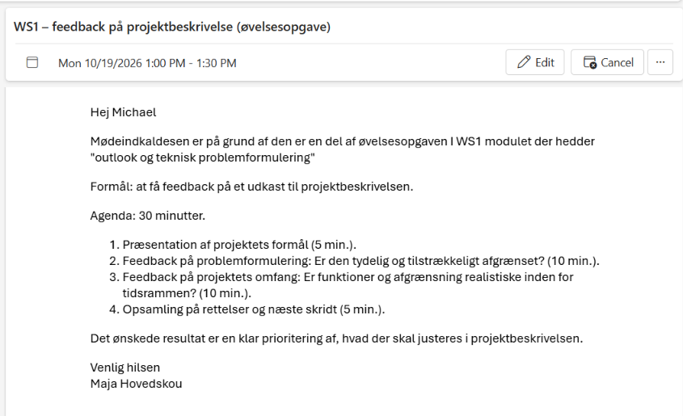
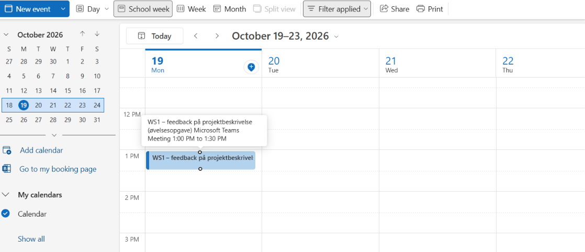

# Outlook og teknisk problemformulering

## På Itslearning

Hej Michael

I forbindelse med WS1-modulet Outlook og teknisk problemformulering har jeg kørt den udleverede `Main.java` uændret i IntelliJ IDEA med Liberica JDK 26.0.2 på Windows.

Programmet viser listen [Anna, Bob, Carl] og beder mig indtaste navnet på den person, jeg vil fjerne. Jeg skriver Anna og trykker Enter.

Jeg forventer, at Anna fjernes, og at listen derefter viser [Bob, Carl]. I stedet stopper programmet med:

```text
java.lang.IndexOutOfBoundsException: Index -1 out of bounds for length 3
```

Fejlbeskeden henviser til `Main.java`, linje 27:

```java
persons.remove(indexOfPersonToRemove);
```

som også har en gul streg under som du kan se på screenshottet.

Kan du hjælpe mig med at forstå, hvorfor fejlen opstår, og hvordan jeg skal undersøge den videre?

Jeg har ikke forsøgt at rette koden, som opgaven foreskriver. Jeg vedhæfter et screenshot af input og fejlbeskeden.

Venlig hilsen  
Maja Hovedskou



### Dokumentation fra Itslearning





## På Outlook

Hej Michael

Mødeindkaldesen er på grund af den er en del af øvelsesopgaven I WS1 modulet der hedder "outlook og teknisk problemformulering"

Formål: at få feedback på et udkast til projektbeskrivelsen.

Agenda: 30 minutter.

1. Præsentation af projektets formål (5 min.).
2. Feedback på problemformulering: Er den tydelig og tilstrækkeligt afgrænset? (10 min.).
3. Feedback på projektets omfang: Er funktioner og afgrænsning realistiske inden for tidsrammen? (10 min.).
4. Opsamling på rettelser og næste skridt (5 min.).

Det ønskede resultat er en klar prioritering af, hvad der skal justeres i projektbeskrivelsen.

Venlig hilsen  
Maja Hovedskou

### Dokumentation fra Outlook




